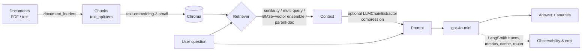
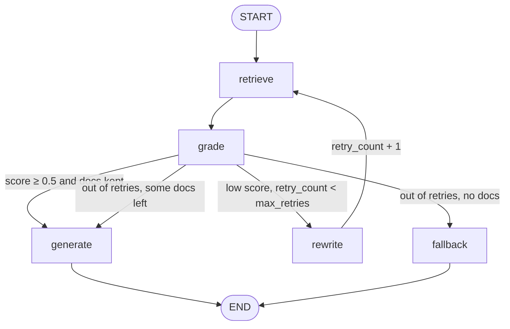

# RAG Production, Part by Part

> A hands-on, runnable walkthrough of Retrieval-Augmented Generation: from loading a PDF to agentic RAG with LangGraph, GraphRAG and vision-based (ColPali-style) retrieval, plus the production concerns of cost, caching, tracing and monitoring.

Each file is a small, self-contained Python script that shows **one** idea. Read it, run it, and watch what it prints.

## What it covers

- **Foundations:** document loading, text chunking, embeddings, Chroma vector store, basic RAG chain with source citations
- **Advanced retrieval:** multi-query, contextual compression, hybrid BM25 + vector (ensemble), parent-document retrieval
- **Production concerns:** LangSmith tracing, query-complexity model routing, response caching, token budgets, structured JSON logging and metrics
- **2026-era techniques (`advanced/`):** long context vs RAG, Anthropic-style Contextual Retrieval, late chunking, agentic RAG on LangGraph, GraphRAG (networkx + Microsoft `graphrag`), multimodal / ColPali-style RAG

## Modules

### Core (repo root)

| File | What it demonstrates |
|---|---|
| `main.py` | Environment check that prints the installed `langchain-core` and `langgraph` versions |
| `document_loaders.py` | `TextLoader` on a temp file and `PyPDFLoader` on `docs/langchain_demo.pdf`, printing per-page content and metadata |
| `text_splitters.py` | `RecursiveCharacterTextSplitter` (size 500, overlap 50) on a Markdown sample; a side-by-side comparison with and without chunk overlap |
| `embeddings_deep.py` | `text-embedding-3-small`: single and batch embeddings, vector norms, hand-written cosine-similarity ranking, `CacheBackedEmbeddings` with a `LocalFileStore` |
| `vector_stores.py` | Chroma: build from documents, `similarity_search`, search with scores, metadata filtering (`{"topic": "database"}`) |
| `rag_pipeline.py` | LCEL RAG chain (retriever → prompt → `gpt-4o-mini` → parser) over an in-memory knowledge base; a variant that cites numbered sources |
| `advanced_rag.py` | `MultiQueryRetriever`, `ContextualCompressionRetriever` + `LLMChainExtractor`, `EnsembleRetriever` (BM25 + Chroma), `ParentDocumentRetriever` with `InMemoryStore`, and a combined multi-query + compression RAG chain |
| `langsmith_setup.py` | `@traceable` runs with custom names, tags and metadata |
| `cost_optimization.py` | `ModelRouter` (an LLM classifies the query as simple or complex, then routes to `gpt-4o-mini` or `gpt-4o` with a rough cost estimate); exact-match response cache with hit-rate stats; `TokenBudget` / `BudgetedLLM` |
| `monitoring.py` | JSON log formatter, `MetricsCollector` (latency, tokens, errors, cache hit rate), `InstrumentedLLM` wrapper |

### Advanced (`advanced/`)

| Script | What it demonstrates |
|---|---|
| `01_long_context_vs_rag.py` | Token-cost comparison with `tiktoken`, latency comparison, a decision framework, and a hybrid approach using Chroma retrieval |
| `02_contextual_retrieval.py` | How chunks lose context; an LLM-generated context prefix per chunk; retrieval with original vs contextualized chunks; a production-style pipeline |
| `03_late_chunking.py` | The pronoun/reference problem with early chunking. Late chunking is **simulated** with OpenAI embeddings, because true late chunking needs token-level embeddings (e.g. Jina). Also covers implementation options |
| `04_agentic_rag.py` | LangGraph `StateGraph`: retrieve → LLM relevance grading → conditional rewrite/retry loop → generate or fallback (diagram below) |
| `05_graphrag_intro.py` | Why vector RAG struggles with multi-hop questions; a hand-built `networkx` knowledge graph with traversal; LLM entity/relationship extraction; the GraphRAG architecture and `graphrag` CLI usage |
| `06_multimodal_rag.py` | Why text extraction loses tables and charts; the ColPali approach explained; a `gpt-4o` analysis of a **text description** of a page (no real images are sent); a reference ColPali implementation shown as code (`colpali-engine` is not installed) |
| `graphrag_demo/` | Microsoft `graphrag` 3.x project: `settings.yaml` (OpenAI `gpt-4.1-mini` + `text-embedding-3-small`, LanceDB vector store), tuned prompts, and a sample corpus `input/nordwave.txt` |

## Tech stack

Python ≥ 3.13 · **uv** · LangChain 1.x (`langchain`, `-core`, `-community`, `-experimental`, `-openai`, `-anthropic`, `-ollama`, `-chroma`) · **LangGraph** (+ SQLite checkpointer) · **LangSmith** · **Chroma** · `rank-bm25` · Microsoft **graphrag** · networkx · tiktoken · numpy · pypdf · bs4 · FastAPI / uvicorn and pytest (declared but not used yet)

Models used in the code: OpenAI `gpt-4o-mini`, `gpt-4o`, `gpt-5.4-nano`, `gpt-4.1-mini` (GraphRAG) and `text-embedding-3-small`.

## Setup

```bash
git clone https://github.com/co-codin/RAG-production-by-parts.git
cd RAG-production-by-parts
uv sync
cp .env.example .env   # then fill in the keys
```

`.env` keys:

| Key | Purpose |
|---|---|
| `OPENAI_API_KEY` | Required: all LLM and embedding calls |
| `ANTHROPIC_API_KEY` | Optional (dependency installed) |
| `LANGSMITH_API_KEY` | For tracing |
| `LANGSMITH_TRACING` | `true` / `false` |
| `LANGSMITH_PROJECT` | LangSmith project name |

## Running

Every script runs on its own. Some files call only one demo from `__main__`; uncomment the others there to run them too.

```bash
uv run python main.py
uv run python document_loaders.py
uv run python text_splitters.py
uv run python embeddings_deep.py
uv run python vector_stores.py
uv run python rag_pipeline.py
uv run python advanced_rag.py
uv run python langsmith_setup.py      # needs LANGSMITH_API_KEY
uv run python cost_optimization.py
uv run python monitoring.py

uv run python advanced/01_long_context_vs_rag.py
uv run python advanced/02_contextual_retrieval.py
uv run python advanced/03_late_chunking.py
uv run python advanced/04_agentic_rag.py
uv run python advanced/05_graphrag_intro.py
uv run python advanced/06_multimodal_rag.py

# Microsoft GraphRAG
uv run graphrag index --root ./graphrag_demo
uv run graphrag query --root ./graphrag_demo --method local  "Who chairs Nordwave's board?"
uv run graphrag query --root ./graphrag_demo --method global "What are the main themes?"
```

## Architecture

### Core RAG pipeline



### Agentic RAG graph (`advanced/04_agentic_rag.py`)



State (`RAGState`): `query`, `rewritten_query`, `documents`, `generation`, `relevance_score`, `retry_count`, `max_retries` (default 2). The grader scores each document from 0 to 1, keeps those scoring ≥ 0.5, and averages only the kept scores.

## Roadmap

- [ ] **Evaluation:** a RAGAS table (faithfulness, answer relevancy, context precision/recall, plus cost and latency) comparing naive RAG, hybrid, contextual retrieval, parent-child, agentic RAG and GraphRAG on the same question set
- [ ] **Real dataset:** replace toy corpora with a real document collection (e.g. legal or financial-compliance documents)
- [ ] **API service:** expose the pipeline through FastAPI (already a dependency) or a Go retrieval service
- [ ] **Docker Compose:** one-command startup for the API and the vector DB
- [ ] Turn the demos into importable modules with pytest tests
- [ ] A true semantic cache (embedding similarity) and real late chunking / ColPali with page images

## License

TBD